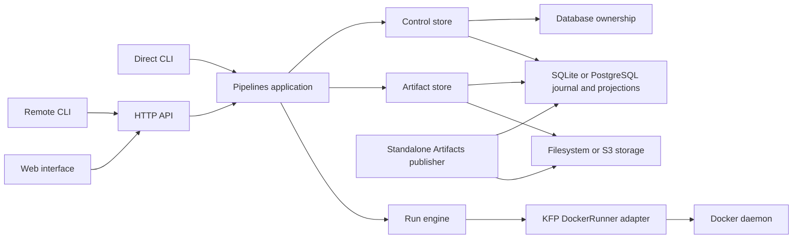

# Architecture

Dockflow executes a supported compiled KFP definition on Docker and retains the
definition, invocation, execution history, logs and artifact provenance. One
instance manages one project. The CLI and HTTP service use the same application
core; the service adds durable queuing and a worker process for each Run.

## Runtime boundaries

In direct mode the foreground process owns the store and executes the Run. In
service mode the API process owns the store for its lifetime. Its scheduler
dispatches one isolated worker process at a time. That worker asks the owner to
perform metadata and artifact operations through an allowlisted process pipe;
it does not open a second state writer. The graph above shows responsibilities,
not a separate network service for each box.

| Module | Responsibility |
| --- | --- |
| `dockflow_cli.main` | Discover installed command groups and expose the shared executable. |
| `config.py` | Parse and validate configuration, resolve paths and record redacted settings. |
| `cli.py`, `client.py` | Direct command adaptation, explicit remote transport and waiting. |
| `service.py`, `kfp_api.py` | Native HTTP boundary, service lifetime, scheduler and bounded KFP client compatibility. |
| `web.py`, `static/` | Packaged browser interface, API documentation and read-only artifact lineage projection. |
| `core.py`, `operations.py` | Definition registration, validation, immutable admission, cancellation and management operations. |
| `definitions.py` | Safely parse supported compiled IR, validate contracts and derive task identity/dependencies. |
| `engine.py`, `reuse.py` | Plan and execute admitted tasks, resolve reuse and historical bindings, enforce publication order. |
| `executor.py` | Version-specific integration with KFP DockerRunner and the Docker transport. |
| `metadata.py` | Accepted records, commit ordering, replay, maintenance and coordination of persistence adapters. |
| `state_database.py` | Domain repositories, transactions, query projections, stable numeric aliases and pinned execution ownership. |
| `ownership.py` | Bounded validation of non-authoritative coordinator diagnostics. |
| `records.py` | Pipeline-specific record identities and lifecycle state sets. |
| `artifacts.py` | Source admission, inventory, verification, materialization and managed publication. |

The listed domain modules are inside Pipelines. The shared `dockflow-core`
distribution owns domain-independent drivers, schema coordination, JSON encoding,
common errors and filesystem primitives. Pipelines owns its execution/cache
schema and queries; Artifacts owns its publication schema and records.
Pipelines and standalone Artifacts both use it; Artifacts does not import the
orchestrator. Artifact storage retains bytes and its identity marker. This does
not introduce extra deployments, databases or background services.

## A Run from admission to completion

1. The adapter parses the request and selects the same `Core` operation used by
   other interfaces. The core validates the compiled definition, typed parameters,
   artifact bindings, selected tasks and effective policies before acceptance.
2. The owner records the immutable submission. The service acknowledges a queued
   Run only after that acceptance is durable. A transport replay with the same
   idempotency key returns the accepted Run.
3. The engine resolves the actual image identity, input descriptors and policy.
   Eligible historical results must pass signature, complete output-set and
   integrity checks. Reuse references the original producer without inventing
   another container attempt.
4. A new attempt receives isolated staging and output paths. The KFP adapter
   prepares native executor inputs and invokes DockerRunner. It observes container
   identity, exit status, logs and confirmed termination.
5. The artifact store validates and publishes each required output. The control
   store commits the complete output set and its SQL projections atomically.
   Only this completed boundary permits success, downstream consumption or reuse.

There is no distributed transaction across artifact storage and SQL. Accepted records
and output-set commits define recoverable ordering. A successful container exit
alone cannot make partial outputs reusable. See [Persistence](persistence.md) for
the durable layout and recovery procedures.

## Ownership and failure recovery

`ControlStore.owner()` acquires the local SQLite inode lock or a shared PostgreSQL
maintenance gate on a pinned session. PostgreSQL adds fenced per-Run leases through
`run_ownership.py`; short project transactions serialize shared mutations.
Sessions never reconnect automatically after uncertainty. Nested participants
retain their acquisition. SQL transactions commit journal and projections together.

After SQLite coordinator loss, new direct admission refuses unresolved prior work.
Service recovery checks the recorded Docker daemon, confirms termination,
captures logs and retires stopped container handles before dispatch. An absent
container on a different daemon cannot resolve execution uncertainty.

PostgreSQL permits successive isolated environments to share complete history;
SQLite retains one project coordinator/Run. PostgreSQL uses per-Run leases so
independent coordinators in the same project can run
concurrently. SQLite remains local-only. Shared state does not provide exactly-once
component side effects or a multi-node task scheduler.

## Dependency and compatibility boundaries

Configuration, validation and core construction initialize no storage and import
no Docker, KFP, PostgreSQL, S3 or server runtime. SQLite uses the standard library;
the PostgreSQL driver loads only when its backend is opened. Native MLMD is no
longer a runtime dependency. Provider/execution adapters initialize on demand.

KFP compatibility has two distinct boundaries: compiled IR accepted by
`definitions.py` and `executor.py`, and official client requests translated by
`kfp_api.py`. Neither implies support for every Kubernetes or Kubeflow feature.
Components remain ordinary externally built container images; Dockflow does not
import a consuming project's Python or build its images on submission.

## Operating limits

SQLite accepts one active Run and task attempt per project. PostgreSQL allows
one active Run per coordinator and sequential tasks per Run. The service queues
additional Runs durably and dispatches them in acceptance order. PostgreSQL instances share the project queue and skip Runs claimed by peers.

Resource pages apply filtering, stable keyset ordering and row limits in SQL.
Log pages select bounded Run/sequence ranges from an indexed projection. Queue,
catalog, idempotency and signature lookups are selective database queries.
Complete integrity checks, rebuild and offline exports intentionally inspect
full history. Each coordinator serves one project and executes tasks sequentially;
PostgreSQL allows multiple coordinators. These query boundaries do not establish
a large-scale throughput or latency guarantee.

Docker execution runs trusted component images with the configured daemon's
privileges and filesystem access. The separate worker process isolates KFP's
process-global runtime configuration; it is not a sandbox for hostile code.

## Cache coordination in the shared database

`cache_registry.py` owns one shared transition protocol with SQLite writer
serialization and PostgreSQL row locking. `cache.py` supervises independent
heartbeats and bounded wait loops. `cache_storage.py` owns portable complete
output manifests over the existing filesystem/S3 adapter. `engine.py` resolves
upstream dependencies before claiming, binds verified hits without new attempts,
and routes cache publication through the journal owner to serialize stop intent.
Registry publication is a separate durable boundary from each Run's output-set
marker. Original producer facts can be imported atomically into another journal.

`dockflow_core.database` supplies the shared backend abstraction for execution and cache
repositories. Consumers supply independent versioned definitions through
`dockflow_core.schema.Schema`: `dockflow_pipelines.database_schema` owns execution
and cache; `dockflow_artifacts.persistence` owns publication records. Core keeps
only a generic version registry and never imports consumers. `[state]`
selects the only physical database. Cache transactions use independent short
connections while execution ownership holds its pinned session. SQLite retains one project coordinator; PostgreSQL coordinators claim distinct
Runs through fenced leases and short project mutation transactions. Database access alone does not provide
shared artifact bytes. See [configuration](configuration.md#coordinated-artifact-cache),
[operations](operations.md#inspect-and-recover-cache-coordination) and
[persistence](persistence.md#cache-registry-authority-and-backup).

## Distributed execution authority

`run_ownership.py` owns PostgreSQL Run claims, heartbeat supervision and fenced
transaction checks. `state_database.py` serializes short shared mutations and
coordinates maintenance through the common backend abstraction. Journal sequence
counters are durable. Service worker RPC retains its parent's Run authority;
direct submissions reserve their Run during acceptance. Worker isolation keeps
KFP's global configuration within one process per execution.

Schedulers skip live claims and recover only abandoned Runs. Recovery verifies
recorded Docker daemon/container identity and stops and retires handles before clearing
uncertainty. A remote live Run is never globally reconciled on startup. Exclusive
maintenance gates exclude other coordinator sessions and independent cache
transactions. Database ownership and artifact availability remain separate.

## Domain repositories

`StateDatabase` stores numeric journal events and exposes repositories for project
metadata, resources, definition sources, output sets, cache observations and log
snapshots. Each resource has one SQL projection keyed by collection/public ID.
Events and projections commit atomically. There is no virtual file tree, optional
index attachment or Pipelines database import facade. Definition and log snapshot
events carry explicit identities; Run authority never comes from parsing a path.

Checks compare the SQL projections with accepted events, including orphaned rows.
Rebuild clears and replays derived domain data in one transaction while preserving
public IDs, numeric aliases, artifact publication records and cache fences.
Payload paths and temporary executor files still refer to actual filesystem/S3
locations; portable backups retain real payload files plus the SQL snapshot.

## Accepted choices and lifecycle supervision

`execution_choices.py` owns the immutable admitted execution value and binds it
to current coordinator access. `lifecycle.py` shares stop-intent merging and
terminal Task transitions between normal completion and recovery. Committed
successes survive recovery; interrupted Tasks and blocked pending work agree
with their terminal Run while unresolved handles retain recovery holds.

The scheduler supervises queue reads, periodic recovery and worker startup. An
escaping failure stops dispatch and admission and revokes readiness. Operators
resolve the cause and restart the service; accepted queue records remain durable.
Remote named-definition inspection follows the current catalog pointer, including
a return to an earlier configured source version.

`queries.py` centralizes backend-neutral selective resource queries over canonical
JSON text. The shared adapter supplies JSON expressions, portable text ordering
and indexes for both databases. Input relationships and retained log entries
have normalized lookup tables. Canonical numeric representations, including
signed zero, remain intact; PostgreSQL JSON casts are query views. `projections.py`
defines replayed values and complete expected row sets for integrity checks.
