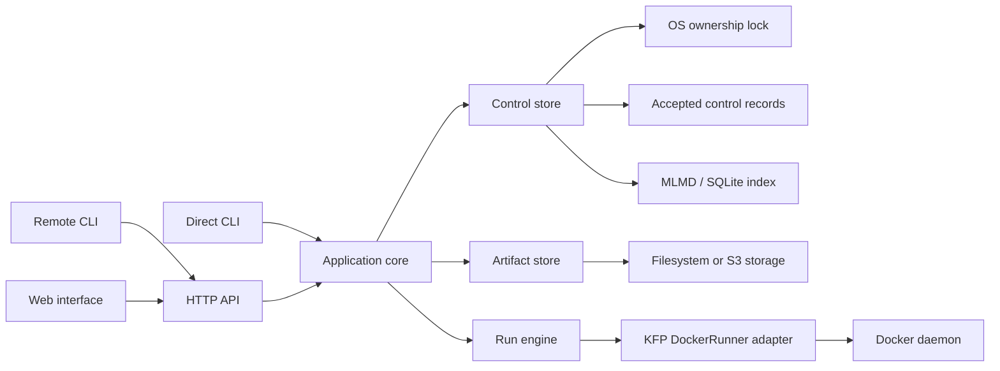

# Architecture

Dockflow executes a supported compiled KFP definition on Docker and retains the
definition, invocation, execution history, logs and artifact provenance. One
instance manages one project. The CLI and HTTP service use the same application
core; the service adds durable queuing and a worker process for each Run.

## Runtime boundaries

In direct mode the foreground process owns the store and executes the Run. In
service mode the API process owns the store for its lifetime. Its scheduler
dispatches one isolated worker process at a time. That worker asks the owner to
perform metadata and artifact operations through an allowlisted process pipe;
it does not open a second MLMD writer. The graph above shows responsibilities,
not a separate network service for each box.

| Module | Responsibility |
| --- | --- |
| `dockflow_cli.main` | Discover installed command groups and expose the shared executable. |
| `config.py` | Parse and validate configuration, resolve paths and record redacted settings. |
| `cli.py`, `client.py` | Direct command adaptation, explicit remote transport and waiting. |
| `service.py`, `kfp_api.py` | Native HTTP boundary, service lifetime, scheduler and bounded KFP client compatibility. |
| `web.py`, `static/` | Packaged browser interface, API documentation and read-only artifact lineage projection. |
| `core.py`, `operations.py` | Definition registration, validation, immutable admission, cancellation and management operations. |
| `definitions.py` | Safely parse supported compiled IR, validate contracts and derive task identity/dependencies. |
| `engine.py`, `reuse.py` | Plan and execute admitted tasks, resolve reuse and historical bindings, enforce publication order. |
| `executor.py` | Version-specific integration with KFP DockerRunner and the Docker transport. |
| `metadata.py` | Accepted records, commit ordering, replay, maintenance and coordination of persistence adapters. |
| `ownership.py` | Stable OS lock, owner identity and bounded conflict diagnostics. |
| `mlmd_index.py` | Lazy MLMD loading and projection of accepted resources into contexts, executions, artifacts and lineage. |
| `records.py`, `canonical.py` | Record identities, versions, UTC timestamps and canonical JSON/hash primitives. |
| `artifacts.py` | Source admission, inventory, verification, materialization and managed publication. |

These are Python modules inside the Pipelines distribution. The separation does
not introduce extra deployments, databases or background services.

## A Run from admission to completion

1. The adapter parses the request and selects the same `Core` operation used by
   other interfaces. The core validates the compiled definition, typed parameters,
   artifact bindings, selected tasks and effective policies before acceptance.
2. The owner records the immutable submission. The service acknowledges a queued
   Run only after that acceptance is durable. A transport replay with the same
   idempotency key returns the accepted Run.
3. The engine resolves the actual image identity, input descriptors and policy.
   Eligible historical results must pass signature, complete output-set and
   integrity checks. Reuse references the original producer without inventing
   another container attempt.
4. A new attempt receives isolated staging and output paths. The KFP adapter
   prepares native executor inputs and invokes DockerRunner. It observes container
   identity, exit status, logs and confirmed termination.
5. The artifact store validates and publishes each required output. The control
   store commits the complete output set and then reconciles the MLMD projection.
   Only this completed boundary permits success, downstream consumption or reuse.

There is no distributed transaction across files, S3 and SQLite. Accepted records
and output-set commits define recoverable ordering. A successful container exit
alone cannot make partial outputs reusable. See [Persistence](persistence.md) for
the durable layout and recovery procedures.

## Ownership and failure recovery

`ControlStore.owner()` acquires a stable `owner.lock` through `StateOwnership`.
The operating system provides exclusion; the UUID, hostname, PID and endpoint in
the file only explain who acquired it. Nested participants of the same coordinator
share the acquisition. Another process using the same underlying state file is
rejected before opening a competing writer, including through a same-host bind
mount.

The control store initializes its journal sequence while holding its coordinator
guard and the OS lock. A failure while inspecting accepted records releases that
acquisition. All subsequent record mutations still require ownership.

After coordinator loss, an OS lock becoming free does not prove task containers
have stopped. Direct Run admission refuses unresolved prior activity. Service
startup confirms container ownership and termination, retains committed outputs,
and resolves recovery holds before dispatch. A reconciliation failure stops new
dispatch instead of guessing that work is safe to repeat.

This design supports local filesystem locking semantics. Network filesystems,
distributed leases, multiple active owners and multi-node scheduling need their
own contracts and qualification.

## Dependency and compatibility boundaries

Importing configuration, compiled-definition validation or constructing the core
does not initialize storage or import Docker, KFP, MLMD, S3 or HTTP-server runtime
dependencies. The index imports its native MLMD runtime when an index is explicitly
opened. The execution and S3 adapters similarly initialize their providers only
when needed. This keeps help, remote clients and offline validation usable without
the execution extras.

KFP compatibility has two distinct boundaries: compiled IR accepted by
`definitions.py` and `executor.py`, and official client requests translated by
`kfp_api.py`. Neither implies support for every Kubernetes or Kubeflow feature.
Components remain ordinary externally built container images; Dockflow does not
import a consuming project's Python or build its images on submission.

## Operating limits

One project accepts one active Run and one active task attempt. The service queues
additional Runs durably and dispatches them in acceptance order. Use separate
project instances when independent workloads must execute at the same time.

List and log responses are bounded, but current collection filtering/sorting and
log selection read the underlying collection or retained entries before producing
a page. Pagination limits constrain the response, not total backend work. A large
retained history or frequent dashboard polling can therefore increase service
memory use and response time. The current deployment profile is a serial,
single-project installation; it does not promise large-scale query performance.

Docker execution runs trusted component images with the configured daemon's
privileges and filesystem access. The separate worker process isolates KFP's
process-global runtime configuration; it is not a sandbox for hostile code.
