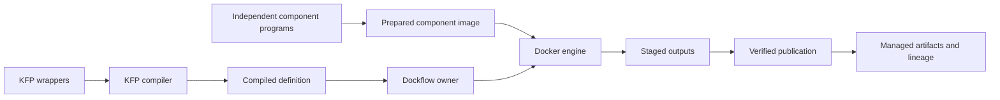

# Concepts

[Documentation index](README.md)

Dockflow separates the description of a computation, its executions, and the
data those executions produce.

| Term | Meaning |
| --- | --- |
| Project | One stable `project.id`, control store, artifact configuration and execution owner. |
| Pipeline | A named catalog entry whose versions are compiled KFP definitions. |
| Definition | An immutable accepted snapshot of compiled YAML/JSON with a `definition_…` ID and SHA-256. |
| Component | A typed input/output contract and executor embedded in a definition, or an explicitly configured compiled component. |
| Run | One accepted pipeline invocation: parameters, input artifacts, selection, reuse policy and result. |
| Task | A graph node in a Run, identified by an exact qualified path such as `prepare` or `group/train`. |
| Attempt | One actual task execution. Retrying creates another attempt. Reuse points to the original successful producer. |
| Artifact | Typed data with an ID, origin, fingerprint, storage location, availability and provenance; files, directories or supported metadata-only values. |
| Experiment | A named grouping of Runs within the project. Omitted experiment selection uses `Default`. |

Parameters are small typed values recorded separately from artifact bindings.
A string parameter is not implicitly a filesystem path or artifact.

## From definition to result

Compilation and image building belong to the consuming project. Dockflow accepts
compiled data, validates supported semantics, creates a durable Run and executes
tasks through KFP DockerRunner. Successful outputs become visible together at a
publication boundary. A downstream task consumes committed outputs, never a
partially uploaded result.

## Direct and service execution

In direct mode the CLI coordinates a foreground Run. In service mode persistent
API processes accept requests from the browser, CLI or HTTP clients. Both use the same application operations and artifact rules.
The service uses isolated worker processes for execution while retaining control
of metadata mutations.

SQLite projects have one active Run and executing task. PostgreSQL supports
concurrent Runs across coordinators, each with sequential tasks. The service can
queue additional Runs; PostgreSQL services claim different queued Runs. Runs move through
`queued`, `running` and optionally `cancelling`, then finish as `succeeded`,
`failed`, `cancelled` or `interrupted`.

SQLite uses a local database-inode lock. PostgreSQL uses per-Run leases and a
shared maintenance gate. Coordinator diagnostics live in SQL and are informational;
Run authority is established by the database ownership protocol. See
[persistence](persistence.md#ownership-and-isolated-environments) for shared state
and process recovery.

## Identity and immutability

Public IDs are opaque, typed IDs such as `run_…`, `task_…`, `attempt_…` and
`artifact_…`. Use the IDs returned by the API instead of constructing them.
Display names help people navigate; they do not replace immutable version IDs.

Uploading a changed version does not change previously accepted Runs. Changing
an image under a mutable tag also does not make it the same computation:
Dockflow resolves the actual image identity before matching reusable execution.

Artifact availability is separate from historical success. A Run remains a
successful historical Run if someone later deletes its output files; those
missing outputs cannot be reused. [Artifact integrity](artifacts.md) and
[metadata recovery](persistence.md) explain the distinction.
