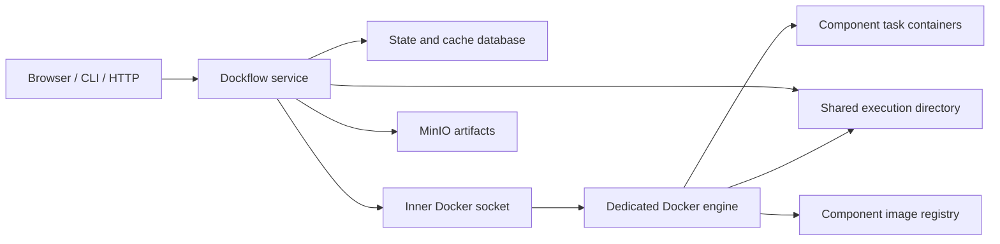

# Deployment

[Documentation index](README.md) · [Compose instructions](../deploy/README.md)

Dockflow supports a foreground local command or one persistent service per
project. The service image is generic: it needs configuration, accepted compiled
definitions, access to component images, state and artifact storage. It does not
need a project-specific Python application installed inside it.

## Choose an execution owner

| Mode | Best fit | Infrastructure |
| --- | --- | --- |
| Direct CLI | Local development and one-off execution. | Local Python runtime and reachable Docker engine. |
| Python service | Browser/API/CLI access to a persistent local project. | Same runtime/engine plus service dependencies. |
| Reference Compose | A self-contained service with isolated image/task state. | Generic Dockflow, dedicated Docker-in-Docker engine, MinIO and registry. |

The [quickstart](quickstart.md) shows direct execution and a persistent Python
service using the same repository-backed files:

```bash
dockflow pipelines --config examples/quickstart/.dockflow-pipelines.toml serve
```

Connect clients explicitly:

```bash
dockflow pipelines --endpoint http://127.0.0.1:8080 runs list
```

The service uses the configuration's storage and Docker connection. Client
settings do not override its state paths, execution limits or artifact backend.

## Reference Compose topology

The repository includes [deploy/compose.yaml](../deploy/compose.yaml), its
[configuration template](../deploy/dockflow.example.toml), and a non-root
[service Dockerfile](../deploy/Dockerfile). Follow the
[deployment README](../deploy/README.md) for complete preparation, build,
start/stop and example-image loading commands.



SQLite needs no separate database container. The `initialize` and `bucket`
services prepare permissions and storage and exit. The long-lived services are
Dockflow, Docker engine, MinIO and registry. The host exposes the Dockflow API
and registry on loopback by default. The engine exposes only its inner Unix
socket to Dockflow.

The engine is privileged in this development topology. It separates task/image
state from the host's engine, but is not a hostile-code isolation boundary. See
[security](../SECURITY.md) before changing its exposure or trust model.

## Which storage contains what?

| Compose volume | Contents |
| --- | --- |
| `dockflow-state` | Project/catalog records, exact compiled snapshots, Runs, logs and state and cache SQLite at `/state`. |
| `dockflow-execution` | Staged inputs, per-attempt outputs and execution scratch at `/execution`. |
| `docker-socket` | Dedicated daemon socket shared with Dockflow. |
| `docker-state` | Docker images, containers and engine metadata at `/var/lib/docker`. |
| `docker-containerd` | Containerd runtime state at `/var/lib/containerd`. |
| `artifacts` | MinIO's managed imports, generated artifacts and provider metadata. |
| `registry-data` | Registry copies of prepared component image layers/manifests. |

Compose prefixes these names with the selected project name. Artifact provider
data includes generated models/reports as well as imported datasets. A
reference-registered external source remains external unless explicitly imported.

## Image availability

The Docker engine that executes a task must be able to resolve its image.
Host Docker, the inner Compose engine and a registry have separate stores.
The service image and component images also have separate purposes.

For local testing, load a host-built component image into the inner engine:

```bash
docker image save dockflow-quickstart-components:v1 | \
  docker compose --env-file deploy/.env -f deploy/compose.yaml exec -T docker-engine \
  docker --host=unix:///docker-socket/docker.sock image load
```

Alternatively push to a reachable registry and compile with that image reference.
In the reference network the inner engine sees `registry:5000`; the host reaches
the registry on `127.0.0.1:5001`. Prepare names explicitly. Dockflow does not
rewrite image references, build images or synchronize caches.

## Repository-backed storage

A service can use `artifacts.backend = "filesystem"` and a bind mount of the
repository's artifact directory instead of MinIO. State/work can also use bind
mounts. This configuration is supported; the supplied Compose file selects S3
and named volumes, so adapt its mounts/services deliberately.

The execution directory must appear at the **same absolute path** in Dockflow
and the daemon's filesystem because the daemon resolves task bind sources.
Match ownership/permissions to the service UID/GID, currently `10001:10001` in
the generic image. Mount external source directories separately and list their
service-visible paths in `artifacts.external_roots`.

A fresh repository can use one project ID, state store and artifact store from
the start. Let the persistent service own them and use its API from the CLI.
Same-host bind aliases share the OS lock; direct writers cannot compete with
the live service. Changing container path names does not rewrite historical
URIs. Combining previously independent histories or relocating stored URIs
requires a deliberate migration. See [persistence](persistence.md).

## Other S3-compatible providers

An S3-compatible service such as SeaweedFS can replace the reference provider
when its required API behavior is verified. Change endpoint, bucket, credentials,
provider startup and durable volume together. Provider disk formats are not
Dockflow's filesystem artifact layout; mounting one provider's raw volume as
`artifacts.root` is not a conversion. Ordinary components continue to receive
staged files and do not require provider credentials.

## Network exposure and stopping

Keep the default loopback exposure for local use. A remotely reachable deployment
needs deliberate TLS termination, access control and token configuration. The
current token represents one trusted service identity; there is no user/RBAC or
multi-tenant account model. All browser assets ship in the Python package and
are served by Dockflow; no separate frontend container or CDN is required.

Cancel or finish active work before planned shutdown. `docker compose down`
preserves named volumes; adding `--volumes` destroys persisted project/storage
data and is not a routine stop command. [Operations](operations.md) covers the
service lifecycle and [persistence](persistence.md) covers offline backups.
